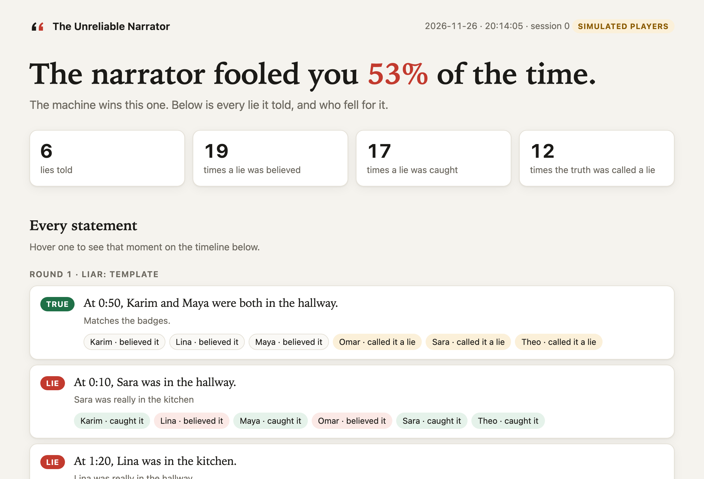
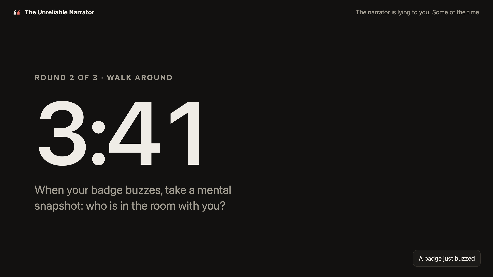
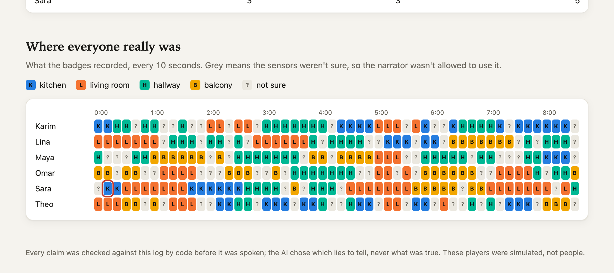
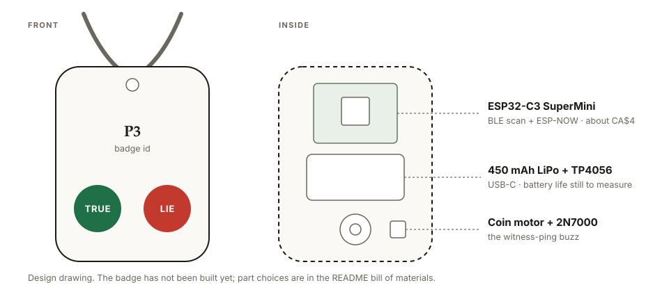
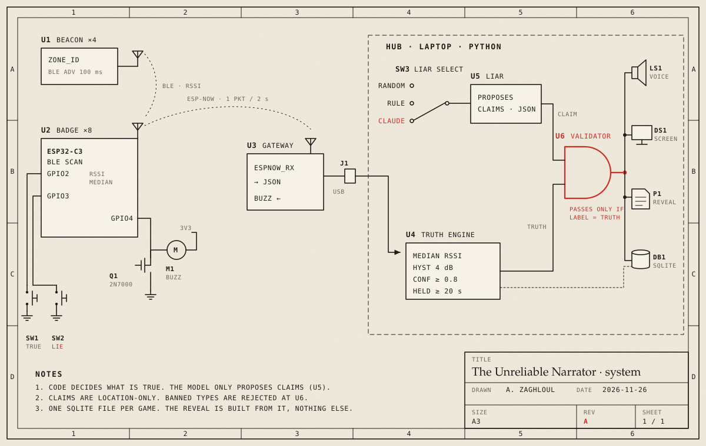

<p align="center"></p>

<p align="center"><b>An in-person party game where the AI narrator is the traitor, and ESP32 badges hold the truth.</b></p>

<p align="center">
Status: <b>software complete, simulator-tested</b> · firmware compiles · hardware not built yet · no real games played yet
</p>

<picture>
  <source media="(prefers-color-scheme: dark)" srcset="docs/images/reveal-dark.png">
  
</picture>

Players walk between rooms wearing cheap badges. At each meeting the narrator announces where people were, for example *"At 3:40, Karim was in the living room."* Some of those announcements are deliberate lies, chosen to turn the group against each other. Players vote TRUE or LIE on their badge. The badges logged where everyone really was, so the reveal shows every lie and who fell for it.

Nobody plays the villain and nobody needs a phone. The game is also an experiment that has so far been run mostly in text-only games: **can people catch a lying AI when they can check its claims against what physically happened?**

## How a game works

| 1. Play | 2. Meeting | 3. Reveal |
|---|---|---|
|  |  |  |
| Walk around for a few minutes. Badges buzz at random moments: remember who is with you. | The narrator reads 4 statements. Some are lies. Argue it out, then press TRUE or LIE before the timer ends. | The real log appears. Hover a statement to light up that moment on the timeline. |

Three rounds make a game. Each round uses a different liar (random, rule-based, then Claude), in an order that rotates between games, so the three can be compared fairly.

## Why it's built this way

- **The AI never decides what is true.** Code works out where everyone was. The AI only picks which lies to tell, as structured claims. A validator re-checks every label, and code, not the model, writes the sentence players hear. See [ADR 0001](docs/adr/0001-llm-never-decides-truth.md).
- **Every lie can be audited.** Every statement, vote and AI call is saved in one SQLite file per game. The reveal is built from that file, so nothing can be hidden.
- **Lies stay inside the game.** Claims can only say where someone was and when. Insinuations like "alone together", claims about what anyone did or said, invented people and real-world places are all rejected. The red-team set ([evals/e4_safety.py](evals/e4_safety.py)) records 0 violations in 41 attacks.
- **Consent first, phones away.** A consent card is read aloud before every game. Data stays on the host laptop, and published data is anonymised and leaves out the raw radio signal. See [docs/HOSTING.md](docs/HOSTING.md).
- **Honest numbers.** Simulated results are labelled as simulated. Claude has to beat the rule-based liar, not just the random one. If it doesn't, this README will say the AI is decorative.

## The badge

<p align="center"></p>

| Part | Qty | Approx. |
|---|---|---|
| ESP32-C3 SuperMini (8 badges, 4 room beacons, 1 gateway, 2 spares) | 15 | CA$60 |
| 400–500 mAh LiPo + TP4056 USB-C charger | 8 | CA$24 |
| Coin vibration motor, 2N7000, 2 tactile buttons, lanyard, case | 8 sets | CA$16 |

The firmware is in [firmware/](firmware/). It compiles for the ESP32-C3 with Arduino-ESP32 core 3.3.13 and NimBLE-Arduino 2.5.2, but has **not been flashed yet**.

## Architecture

<p align="center"></p>

**How the truth engine places a player** ([hub/truth.py](hub/truth.py)). For each player, every 10 s:

1. Take the median signal strength (RSSI) per beacon.
2. Pick the strongest beacon.
3. Keep the previous room unless the new one is at least 4 dB stronger.
4. Score a confidence.

The narrator may only use facts that are confident and held for at least 20 s.

| Module | Role |
|---|---|
| [hub/live.py](hub/live.py) | The game: play phase, witness buzzes, meetings, button votes |
| [hub/truth.py](hub/truth.py) · [hub/validator.py](hub/validator.py) | Truth from radio signal strength · the gate every claim passes through |
| [hub/liars.py](hub/liars.py) · [hub/llm.py](hub/llm.py) | Random and rule-based liars · Claude liar (structured output; every call logged with cost) |
| [hub/screen.py](hub/screen.py) · [hub/reveal.py](hub/reveal.py) | Big-screen page · reveal page (self-contained HTML, works offline) |
| [hub/transport.py](hub/transport.py) | Real USB gateway, or a fake one driven by the simulator |
| [hub/walk.py](hub/walk.py) · [hub/export.py](hub/export.py) | Walk-test recorder · anonymised dataset export |

## Try it

You don't need any hardware: the fake gateway plays a whole game with simulated players.

```sh
uv venv -p python3.12 .venv && uv pip install -p .venv anthropic pytest
.venv/bin/python -m pytest -q                  # 26 tests
.venv/bin/python -m hub.live --sim             # full game, opens the reveal page
.venv/bin/python -m hub.screen                 # big screen: /?demo=play, /?demo=meeting, /?demo=over
.venv/bin/python -m evals.e4_safety            # red-team: must print 0 violations
```

The Claude liar needs Anthropic credentials (`ANTHROPIC_API_KEY` or `ant auth login`). The model is set by `NARRATOR_MODEL` (default `claude-opus-5-5`). A game makes 3 calls, so it costs cents.

Without credentials, that round is filled by the random liar. Those statements are marked `template-fill`, and the analysis never credits them to Claude.

To run a real game night, see [docs/HOSTING.md](docs/HOSTING.md). It covers setup, the walk test, the rules and the consent card.

## Evals

| Eval | Question | Result so far |
|---|---|---|
| E1 sim · [e1_zone_accuracy](evals/e1_zone_accuracy.py) | Are the facts the narrator uses right? | 99.8% correct in the simulator. Usable facts drop from 70% to 39% as noise rises |
| E1 bench · [walk](hub/walk.py) + [e1_bench](evals/e1_bench.py) | The same question on real hardware, against a naive baseline | Needs hardware |
| E2 · [e2_validator](evals/e2_validator.py) | Is every accepted lie really false, and every truth really true? | 2344/2344 lies and 1438/1439 truths correct. The one miss is a room-boundary error in the truth engine |
| E3 · [e3_analysis](evals/e3_analysis.py) | Do Claude's lies fool people more than rule-based lies? | Needs real players. The pipeline has been checked on simulated sessions only |
| E4 · [e4_safety](evals/e4_safety.py) | Can the liar or a player name break the rules? | 0 violations in 41 attacks |
| E5 · [e5_models](evals/e5_models.py) | Which model is accurate, fast and cheap enough? | Not run yet (costs money) |

Run notes: [evals/results.md](evals/results.md). The images in this README are generated from real code paths by [scripts/make_images.py](scripts/make_images.py). The game they show used simulated players.

## Known limitations

- Everything is simulated so far. The signal-strength model is a guess until it's checked against bench data.
- The simulated voters are crude. Only real players can show whether one liar beats another.
- Ctrl+C ends the game; there is no pause-and-resume.
